# Price Monitor

Monitors prices and stock of products in a few fixed catalogs. It keeps the history in SQLite, sends Telegram alerts for the products you track, and builds XLSX reports.

**Status: release 1 is feature-complete and runs on a server.** What is checked and what is not: [docs/ACCEPTANCE.md](docs/ACCEPTANCE.md). Demo video (1:50, subtitles): https://youtu.be/h9beBnU3xPE. Screenshots from a real Telegram chat are in [Real chat](#real-chat) below.

## What it does

**The problem.** Prices and availability in online shops change all the time, and checking them by hand means opening the same pages again and again. Typical cases: waiting for a price to fall below a number, knowing the moment an out-of-stock item returns, or watching a supplier's or competitor's catalog for removed and repriced products.

**What it does.** You pick the products to follow. The service visits the shop's catalog on a schedule, remembers every price and stock status, and sends a Telegram message only when something you follow changes: the price fell (below your limit or by your percentage), the item sold out or came back, it disappeared from the catalog or returned. A message says which shop and product, what changed (was → now), why you received it, and how to turn it off. On request it builds an XLSX report with the current state and the history of changes.

**What it is careful about.** It does not report changes it is not sure about. If a page fails to load, the layout changed, or the catalog looks incomplete, nothing is recorded and you are told the shop is unavailable, instead of getting "all products disappeared". A product counts as removed only after two complete checks in a row without it.

**What it watches.** A real shop: the *car FM transmitters* category of [xcom.ua](https://xcom.ua), a Ukrainian online store (about 50 products on 2 pages, read as plain HTML, one collection every 6 hours with the 10-second pause between pages that the shop's robots.txt asks for). Real prices and stock change on their own schedule, so alerts from it arrive when the shop really changes something. The larger shops tried first (allo.ua, brain.com.ua, rozetka, foxtrot) answer requests from a datacenter address with HTTP 403; the monitor stops on 403 and does not try to get around it, so xcom.ua is the real shop on the server. An adapter for one allo.ua category is also included and was checked from a home connection.

To show every kind of reaction on demand (price drop, sold out, product removed, shop broken) there is also **Demo Shop**, a fictional shop that ships with the project. It is a test bench whose prices and stock are changed by a script, so the whole story can be played and recorded. Messages from the real shop and from the test bench look the same.

How the demo shop looks:

| Before | After the `price_drop` scenario |
| --- | --- |
| 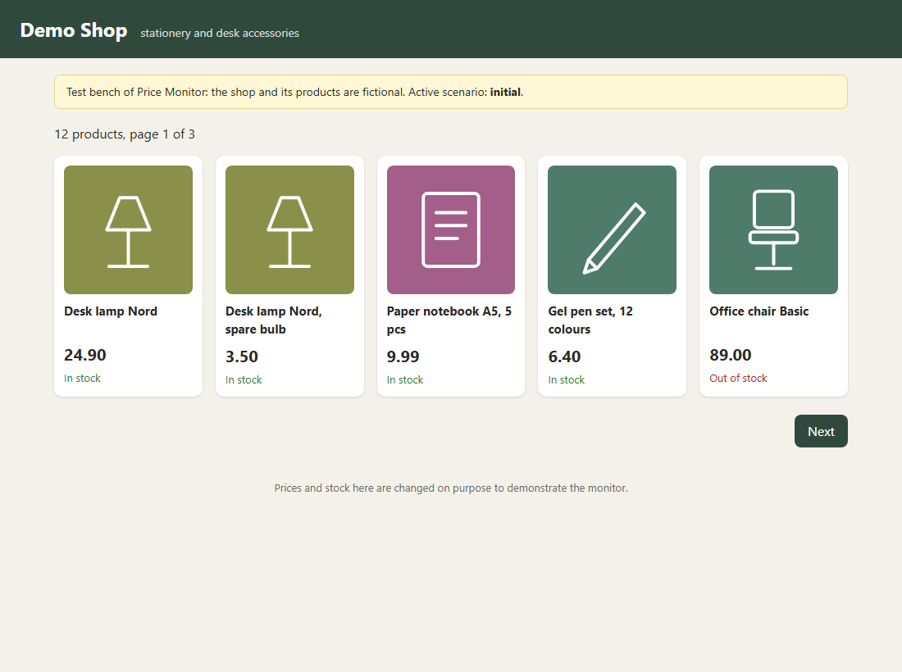 | 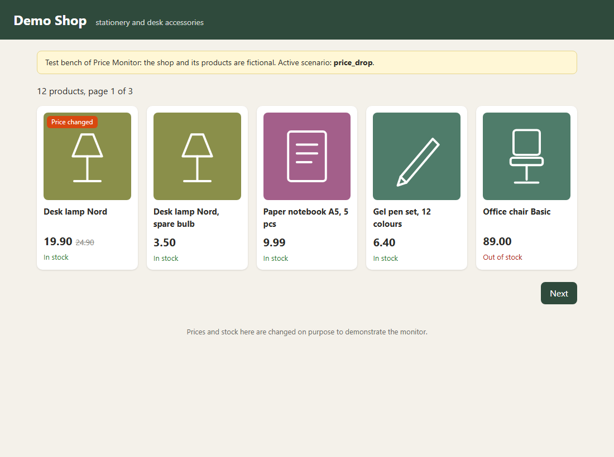 |

The monitor notices the new price and sends a message with a picture card. These cards are produced by the program from a demo run (PNG files created by `cards.py`; Telegram displays the same image with a caption):

| Price dropped | Sold out | Back in stock | Removed from catalog |
| --- | --- | --- | --- |
| 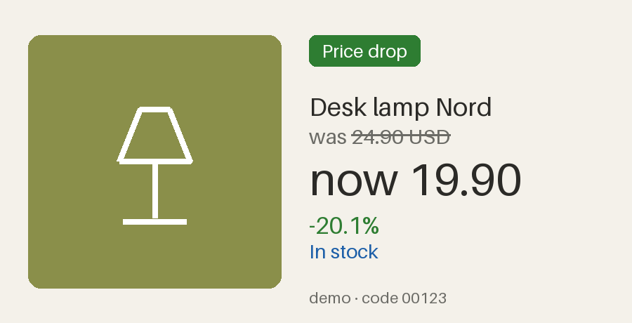 | 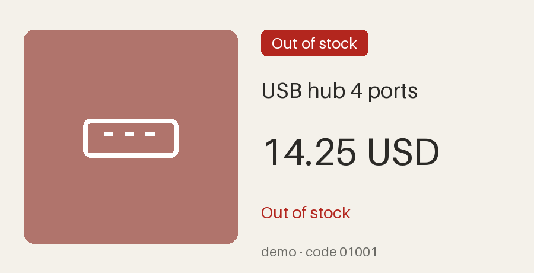 | 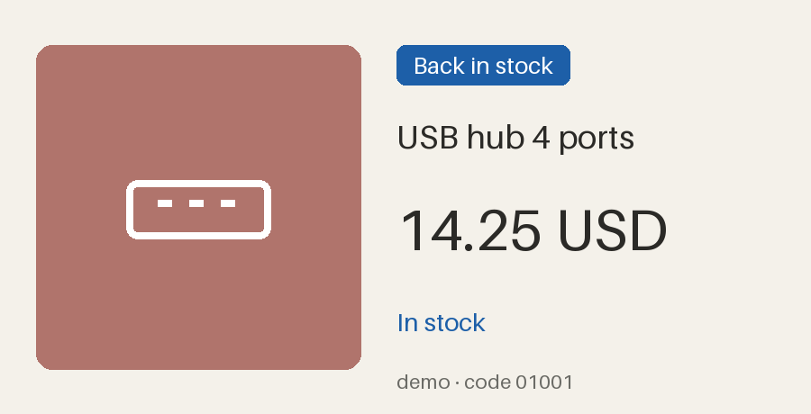 | 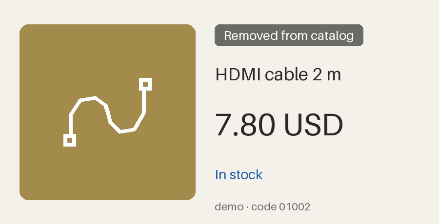 |

### Real chat

Screenshots from a recording of a real Telegram chat with the bot, watching the demo shop (a fictional test bench, so the changes are scripted):

| Product card with tracking buttons | Price drop and stock alerts | Stock back, product removed |
| --- | --- | --- |
| 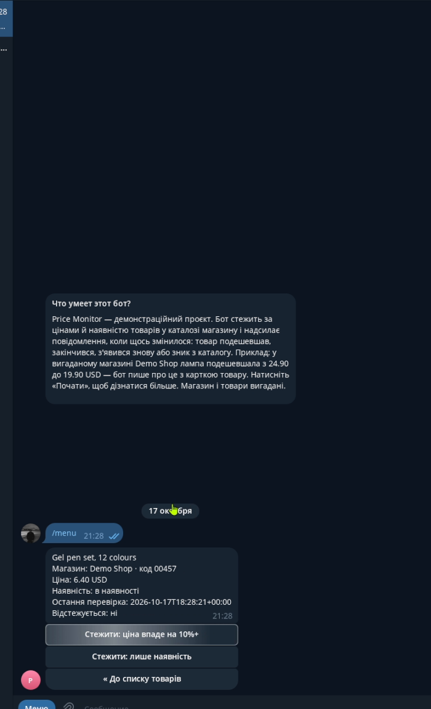 | 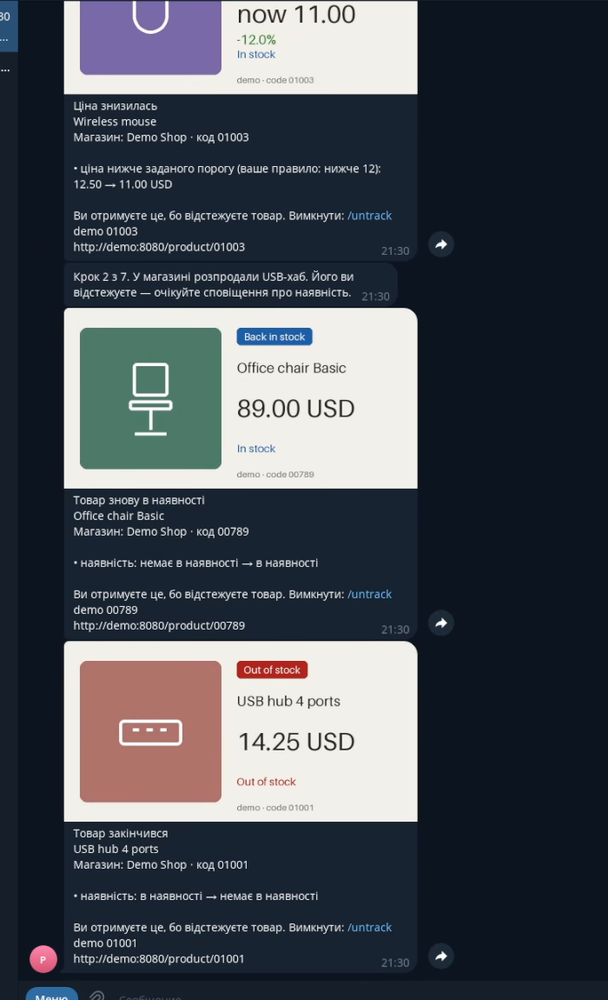 | 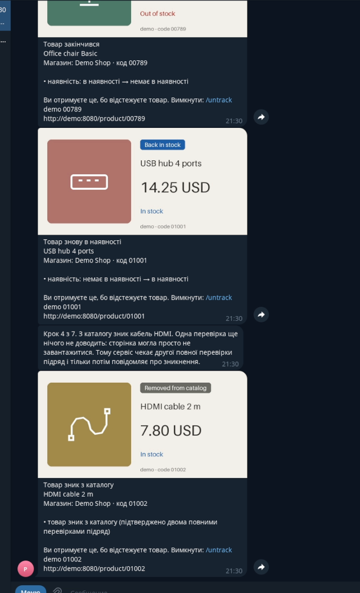 |

| Source failure and recovery | XLSX report |
| --- | --- |
| 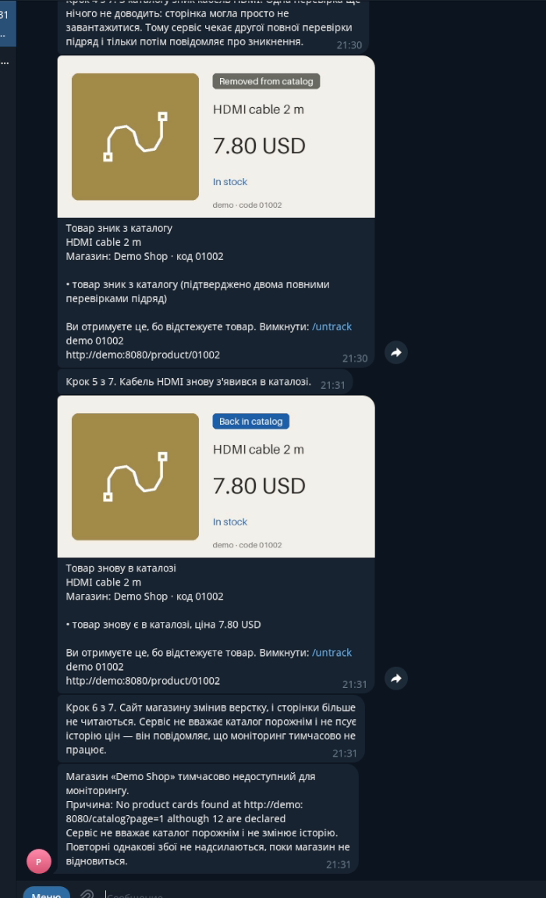 | 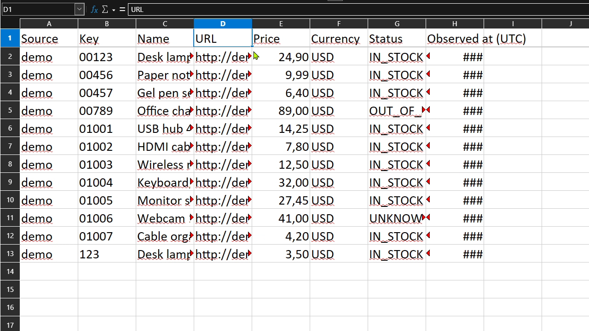 |

### Play the whole story

`price-monitor demo-play` runs the scenarios one after another with pauses, so it can be screen-recorded: prices drop, an item sells out and comes back, a product disappears and returns, the source breaks and recovers, and a report is written. Each step switches the demo catalog, runs a real collection and lets the service deliver the Telegram messages. Before every step the bot also sends a short explanation of what just happened in the shop (the only messages that are not alerts), so a viewer who joins the chat cold can follow the story. The bot's own page and `/start` explain what the project is and what it watches.

```bash
docker compose exec monitor price-monitor demo-play --pause 20
```

Sources in this release:

- `xcom` — one category of [xcom.ua](https://xcom.ua) (car FM transmitters), a real shop. Switched on with `PRICE_MONITOR_ENABLE_XCOM=1`. Prices and the shop's own stock wording are read from schema.org markup ("Есть на складе" → in stock, "Нет в наличии" → out of stock).
- `allo` — one category of [allo.ua](https://allo.ua) (fitness bands), a real shop that refuses datacenter addresses (HTTP 403), so it works from a home connection only. Switched on with `PRICE_MONITOR_ENABLE_ALLO=1`. Stock is inferred from the card's button ("Купити" → in stock, "Повідомити про наявність" → out of stock, "Замовити" with no price → unknown). Cards without a price are kept with no price.
- `demo` — a small local catalog that ships with the project, a **test bench**: its prices and stock are changed on purpose to show how the monitor reacts.
- `books` — [books.toscrape.com](https://books.toscrape.com), a public practice site. Its prices and stock never change, so live collection there shows only parsing and pagination. Off by default.

Out of scope: supplier price-list import, ad monitoring, browser automation, CAPTCHA/anti-bot bypass, proxies, a web UI, several currencies.

## Quick start (Docker Compose)

```bash
docker compose up --build
```

This starts the demo catalog (http://127.0.0.1:8080) and the monitor, which collects it every 60 seconds. No Telegram token and no external network are needed. The database is stored in the `data` volume and survives restarts.

Or try one change by hand on the demo catalog:

```bash
docker compose exec monitor price-monitor collect demo
docker compose exec demo price-monitor demo-scenario price_drop
docker compose exec monitor price-monitor collect demo
docker compose exec monitor price-monitor report --since 2026-01-01 --until 2027-01-01
docker compose cp monitor:/data/reports ./reports
```

The second `collect` prints `Events: PRICE_CHANGED x2`. `docker compose exec demo price-monitor demo-scenario` without a name lists all scenarios (price drop, stock changes, lost page, pagination loop, missing products, changed page template, and so on).

## Local run without Docker

Python 3.11+.

```bash
python -m venv .venv
.venv/Scripts/pip install -e ".[dev]"      # Linux/macOS: .venv/bin/pip
price-monitor demo-serve &                  # catalog on 127.0.0.1:8080
price-monitor collect                       # one collection, no Telegram needed
price-monitor report --since 2026-01-01 --until 2027-01-01
price-monitor run                           # service: schedule + Telegram (if configured)
pytest
```

Files go to `./data` by default (`PRICE_MONITOR_DB`, `PRICE_MONITOR_REPORTS`, `PRICE_MONITOR_DEMO_STATE` change that).

## Telegram

Set both `TELEGRAM_BOT_TOKEN` and `TELEGRAM_ALLOWED_IDS` (comma-separated numeric user IDs; see `.env.example`). Without both, Telegram stays off. Only allowlisted IDs get answers; everyone else receives "Доступ заборонено." The interface language is Ukrainian.

| Command | Action |
| --- | --- |
| `/sources` | sources, time of the last successful collection, state |
| `/products <source>` | products from the last snapshot |
| `/tracked` | tracked products and their rules |
| `/track <source> <key> [below=PRICE] [drop=PERCENT]` | start or update tracking (repeating it changes nothing) |
| `/untrack <source> <key>` | stop tracking |
| `/report [source] [days]` | XLSX report, 7 days by default, at most 90 |
| `/status` | notification queue and the last delivery error |

Product keys are strings: `00123` and `123` are different products.

### Buttons

`/start` and `/menu` open a button menu, so commands are rarely needed: **Shops** → a shop (its products, 8 per page, and 1-day / 7-day reports) → a product card (price, stock, link to the shop, **Track** / **Stop tracking**), **Tracked**, **XLSX report**, **Service status**, **About**. Typing part of a product name or its code searches all shops. The presets on a product card are "alert if the price falls by 10% or more" and "only stock changes and removal"; other thresholds (`below=`, `drop=`) are set with `/track`.

Alerts are sent only for tracked products, one message per product and collection, listing every reason that fired: price crossed below `below`, price fell by at least `drop` percent, stock changed between IN_STOCK and OUT_OF_STOCK, the product was confirmed removed, or it came back. A source outage is reported once, and its recovery once.

## How changes are decided

- A collection is stored only if the whole catalog was read: every page answered, no pagination loop, no duplicate keys, the product count matches the count the page declares, the page limit was not hit. Otherwise the run is marked failed and the previous snapshot stays the baseline.
- The first successful collection is a baseline and produces no events.
- `OUT_OF_STOCK` (the page says so) is not the same as a product missing from the catalog, and `UNKNOWN` (no stock information) is neither. Only IN_STOCK ⇄ OUT_OF_STOCK produces a stock event.
- A product is `REMOVED` after two consecutive full successful collections without it. A failed collection in between restarts the count. When it reappears, a `RETURNED` event is created.
- Prices are `Decimal`; percentages are computed exactly. A previous price of 0 never produces a percentage drop.
- Events and queued notifications are written in the same transaction as the snapshot.

## Operating notes

- **One instance.** `price-monitor run` takes a file lock (`service.lock` next to the database); a second service exits. A per-source file lock also stops a manual `collect` from running alongside a scheduled one.
- **After downtime** exactly one fresh collection runs, then the normal interval; missed intervals are not replayed.
- **Delivery is at-least-once.** If Telegram does not answer in time, the message may still have arrived and is sent again, so a rare duplicate is possible. A message is retried up to 6 times with growing delays; a blocked bot or unknown chat is not retried. Failed messages stay in the database and show in `/status`.
- **HTTP 401/403** stops the source. After checking the access terms, resume it with `price-monitor resume-source <source>`.
- **Backup:**
  ```bash
  docker compose exec monitor python -c "import sqlite3; s=sqlite3.connect('/data/price_monitor.db'); s.backup(sqlite3.connect('/data/backup.db'))"
  docker compose cp monitor:/data/backup.db ./backup.db
  ```
- The schema is versioned (`PRAGMA user_version`); a newer database than the program is refused.

## Reports

`price-monitor report --since DATE --until DATE` (UTC, end excluded) writes `Current` (latest observation per product) and `History` (events in the period). Keys stay text, names that start with `=`, `+`, `-` or `@` are stored as text, not formulas. A report larger than 50 000 rows is refused with a request for a shorter period. The file name is generated; a path cannot be chosen.

## Verification

Checked by automated tests (`pytest`, no network, no token): parsing against HTML fixtures, pagination and network failures against a real local HTTP server, comparison rules and boundaries, REMOVED/RETURNED, transactional events + queue, restart of the queue, outage alerts, the file lock across processes, Telegram command logic and the allowlist, XLSX contents.

Run by hand:

- `books` live collection: 1000 products from 50 pages, a repeat gave no events.
- `allo` live collection from a home connection: 164 products from 3 pages (141 in stock, 17 out of stock, 6 priceless "order" cards). From the VPS it gets HTTP 403, the source is stopped and the operator is told once.
- `xcom` live collection, locally and from the VPS: 52 products from 2 pages (37 in stock, 15 out of stock).
- `docker compose up --build` on an aarch64 Ubuntu 24.04 VPS: both containers start, the scenario from the quick start gives the documented result, the database and events survive `down` / `up`.
- `price-monitor run` without Telegram: scheduled collection works, a second instance is refused.
- CI on GitHub Actions: every push runs `pytest` on Python 3.12 and builds the image; the runs are green.

**Not verified:**

- Delivery of the XLSX file itself in the chat: the report is built and opens correctly, but sending it through Telegram has not been recorded.
- The behavior of the `books` site if it changes its markup: a changed template is reported as a failed collection, not as an empty catalog.

## Limitations

- Completeness cannot be proven beyond structural checks (declared count, pagination, duplicates); a source that silently drops a card and updates its declared count would not be noticed.
- `Retry-After` is not honored; retries use fixed exponential delays. Redirects are treated as failures.
- A stock change that passes through `UNKNOWN` between two collections is not reported.
- Stock is only IN_STOCK / OUT_OF_STOCK / UNKNOWN; exact quantities are not read.
- The demo catalog has one currency; `books` prices are GBP. There is no conversion.
- Single process, single machine. No distributed queue.
- **Real shops (xcom.ua, allo.ua):** their robots.txt files allow category pages for generic crawlers and the volume is low (2–3 pages every 6 hours, with pauses of 10 s and 3 s between pages, an identifying User-Agent with the project URL), but their terms of service have **not** been reviewed by the author. Check them before running this against a real shop for anything beyond a personal demo. Adapters depend on the shops' page layouts; a layout change makes collections fail and the bot says so, it does not guess. The pages give no product total, so completeness rests on the pager and equal page sizes.
- The shop shows no stock count on listing cards, so "in stock" means "the Buy button is shown".

## Documentation

- [docs/design.md](docs/design.md) — why the project is shaped this way: scope, completeness checks, change rules, delivery guarantees, trade-offs.
- [docs/ACCEPTANCE.md](docs/ACCEPTANCE.md) — the release criteria and what was actually checked for each.
- [docs/video-script.md](docs/video-script.md) — the script of the demo video.

## License

MIT.
